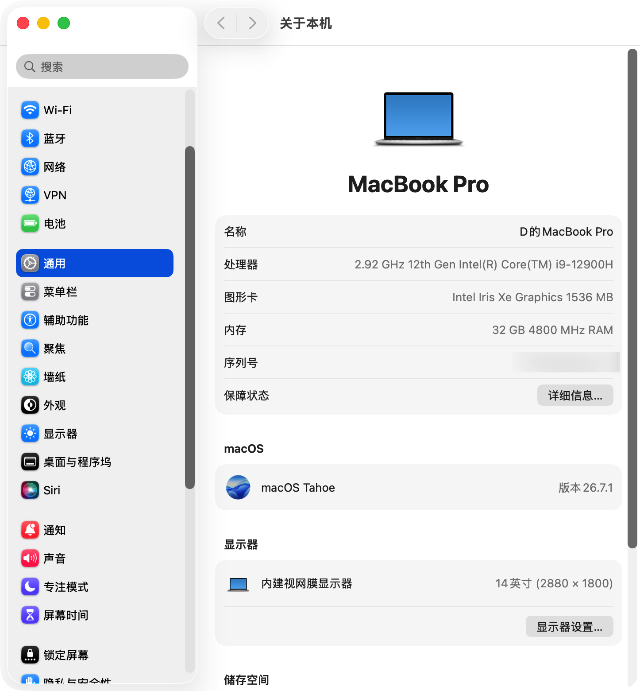
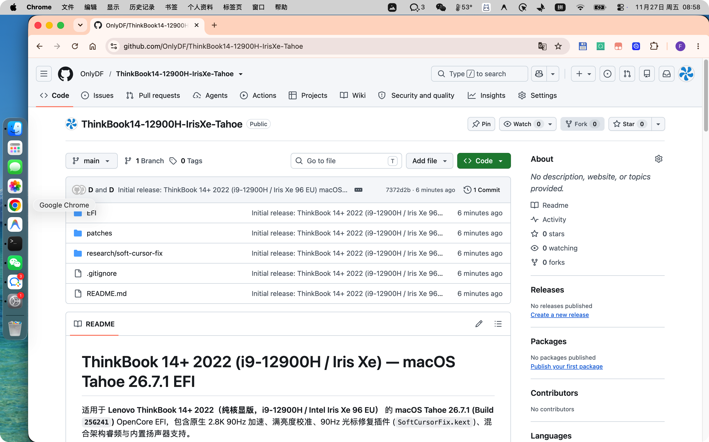

# ThinkBook 14+ 2022 (i9-12900H / Iris Xe) — macOS Tahoe 26.7.1 EFI

[中文](README.md) | **English**

OpenCore EFI for **Lenovo ThinkBook 14+ 2022 (iGPU-only, Intel Core i9-12900H / Intel Iris Xe 96 EU)** running **macOS Tahoe 26.7.1 (Build `25G241`)**, featuring native 2.8K 90Hz acceleration, full-brightness PWM calibration, 90Hz cursor stripe fix (`SoftCursorFix.kext`), hybrid CPU turbo/power management, and built-in speaker audio.

> **Important Version Restriction**: The graphics stack and kernel patches in this repository are strictly tied to **macOS Tahoe 26.7.1 (`25G241`)**. Do not casually install macOS point updates.

---

## Screenshots

| About This Mac (i9-12900H / Iris Xe 1536 MB / 2880×1800) | Daily Desktop (2.8K 90Hz HiDPI / 45°C Idle) |
| :---: | :---: |
|  |  |

---

## Hardware & Feature Status

| Component | Hardware / Solution | Status | Notes |
| :--- | :--- | :---: | :--- |
| **Model** | Lenovo ThinkBook 14+ 2022 (iGPU-only) | ✅ | Disable Secure Boot in BIOS, set storage to AHCI/NVMe, keep E-cores enabled |
| **CPU** | Intel Core i9-12900H (6P + 8E, 20 threads) | ✅ | `CpuTopologyRebuild` + `ngreenpm=64` unlocks hybrid HWP/EPP turbo, C8/C10 power saving, and 64W sustained PL1 (bypasses EC 25W cap) |
| **iGPU** | Intel Iris Xe 96 EU (`8086:46A6`) | ✅ | Spoofed `9A49` + `NootedGreen` + `YogaGMSFix` (60 MiB GMS) + Metal 2 / Liquid Glass |
| **Internal Display** | AUO `B140QAN04.0` (2880×1800 @ 90Hz) | ✅ | Native `1440×900 @ 90Hz` HiDPI; `ngreenblmax=17777` restores full 0–100% brightness |
| **90Hz Cursor** | `SoftCursorFix.kext` (`-swcursor`) | ✅ | Fixes 90Hz hardware cursor horizontal black stripes via Apple's native Metal software cursor fallback |
| **Audio** | Realtek ALC257 (`alcid=99`) | ⚠️ | `AppleALC` + `SimpleHDA 1.0.2` (`MinKernel=25.0.0`); built-in speakers, 3.5mm headphone output, and Bluetooth mic work; internal Intel SST DMIC array mic is unsupported and 3.5mm combo-jack mic has no input under `alcid=99` |
| **Wi-Fi / Bluetooth** | Intel AX210 (replaces stock MT7921) | ✅ | `AirportItlwm-Tahoe` + `itlwm_he=1` for native Wi-Fi 6 menu; `IntelBluetoothFirmware` + `BlueToolFixup` with AirPods auto-switching |
| **Keyboard / Trackpad** | Built-in Keyboard + ELAN0662 (I2C) | ✅ | `VoodooPS2Controller` + `VoodooI2C` (`-vi2c-force-polling`) |
| **Display Sleep / S0ix** | `XE-FBDPMS` + S0ix disabled | ⚠️ | **Display sleep & wake work reliably**; S3/S0ix full system sleep is unsupported (must be disabled — see below) |
| **HW Video Decode** | H.264 / HEVC (`-ngreengva`) | ✅ / Optional | `-ngreengva` enabled by default; requires manually installing upstream `VADriver` (remove `-ngreengva` if you need FairPlay DRM in Apple Music / TV+) |
| **AirDrop / Thunderbolt** | AWDL / Thunderbolt 3 | ❌ / Disabled | Intel Wi-Fi does not support AirDrop/AWDL; Thunderbolt SSDT is disabled by default |

---

## Repository Layout

```text
.
├── EFI/
│   ├── BOOT/
│   └── OC/
│       ├── config.plist            # Daily accelerated config (fully tuned, SMBIOS stripped)
│       ├── config-install.plist    # Unspoofed installer & permanent rescue config (SMBIOS stripped)
│       ├── config-register.plist   # One-time 9A49 registration transition config (SMBIOS stripped)
│       ├── ACPI/                   # Model-specific ACPI patches
│       ├── Drivers/                # OpenCore UEFI drivers
│       └── Kexts/                  # Complete kext set (NootedGreen / YogaGMSFix / SoftCursorFix / SimpleHDA)
├── patches/
│   └── thinkbook-register.patch    # Upstream install script patch adapted for ThinkBook
├── research/
│   └── soft-cursor-fix/            # SoftCursorFix.kext source code and native macOS build script
└── tools/
    ├── xe-watchdog.py              # Lightweight health watchdog (GPU/GART/crash loops/95°C temp)
    └── XeNotify.swift              # Native macOS alert notifier (opens Terminal with prefilled confirm command)
```

---

## Quick Start Guide

### 1. Generate and Fill Your Own SMBIOS
All three plists (`config.plist`, `config-install.plist`, `config-register.plist`) have their SMBIOS values cleared.  
Use [GenSMBIOS](https://github.com/corpnewt/GenSMBIOS) to generate a **`MacBookPro16,2`** identity and populate `SystemSerialNumber`, `MLB`, `SystemUUID`, and `ROM` **across all three plist files**.

### 2. Three-Stage Deployment
1. **Install macOS (`config-install.plist`)**
   - Temporarily replace `EFI/OC/config.plist` on your USB installer with `config-install.plist` (no GPU spoof, uses `-igfxvesa`).
   - Install **macOS Tahoe 26.7.1 (`25G241`)** to your target NVMe drive, boot to the desktop, and verify `sw_vers -buildVersion` returns `25G241`.
2. **Register the TGL Graphics Stack (`config-register.plist`, run once only)**
   - Switch the active USB config to `config-register.plist`, reboot, and verify `IGPU` reports `device-id = <499a0000>`.
   - Clone upstream [Hackintosh-XPS13Plus-IrisXe-Tahoe](https://github.com/JulioNectar/Hackintosh-XPS13Plus-IrisXe-Tahoe), apply `patches/thinkbook-register.patch` from this repo, and run `zsh install.sh` to install the graphics driver, Metal bundle, and shader compiler, then rebuild AuxKC (approve the system extension in *Privacy & Security*).
   - > **Warning**: Once the TGL driver is installed on the system volume, **never boot with `config-register.plist` again**. Whenever you need unaccelerated rescue boot, use `config-install.plist` only.
3. **Boot Daily Accelerated Desktop (`config.plist`)**
   - Switch back to the default `EFI/OC/config.plist` and reboot into native `2880×1800 @ 90Hz` Metal 2 acceleration.
   - Once verified stable, copy the complete `EFI` folder to the dedicated EFI partition on your macOS NVMe drive and keep the USB drive as a rescue disk.

---

## Recommended Post-Install Tuning

### 1. Disable System Sleep, Keep Display Sleep Only (Strongly Recommended)
The ThinkBook 14+ 2022 only supports Modern Standby (S0ix), which cannot wake cleanly under macOS. Lock the machine to "display sleep only, no system sleep":

```bash
sudo pmset -a sleep 0 disablesleep 1 hibernatemode 0 standby 0 powernap 0 proximitywake 0 halfdim 1 disksleep 10
sudo pmset -c womp 0 displaysleep 10
sudo pmset -b displaysleep 3
sudo rm -f /var/vm/sleepimage
```

### 2. Dual-NVMe Coexistence with Windows
If macOS and Windows are installed on separate NVMe drives, set `Misc > Security > ScanPolicy` to **`257`** (APFS only) in the internal macOS OpenCore config so OpenCore only boots macOS. Press **`F12`** at startup and choose `Windows Boot Manager` whenever you want to boot stock Windows untouched.

### 3. Smoothness & Optional Tweaks
- **UI Smoothness**: Enable **Reduce Transparency** (*System Settings → Accessibility → Display*) to significantly cut Tahoe Liquid Glass compositing overhead in 3D maps, remote desktop, and other graphics-heavy apps.
- **Wi-Fi 6 (802.11ax)**: `itlwm_he=1` is enabled by default in `config.plist` for AX210 Wi-Fi 6 speeds.
- **H.264 / HEVC Hardware Decode**: `-ngreengva` is included by default in `config.plist`; build/install `/Library/GPUBundles/AppleIntelTGLGraphicsVADriver.bundle` from the upstream repo to activate it (remove `-ngreengva` if you need FairPlay playback in Apple Music / Apple TV+).
- **Key Boot-Args**:
  - `-xenobb`: Skips `XE-BOOTHOLD` boot-time blanking wait to prevent black-screen lockups at boot.
  - `ngreenblmax=17777`: Matches the `96000` PWM period of the `AUO B140QAN04.0` panel to restore 100% max brightness.
  - `-swcursor`: Enables `SoftCursorFix.kext` (remove it or add `-swcursoroff` to disable).
  - `ngreenpm=64`: Enables hybrid CPU turbo/power management and sets MCHBAR PL1 to 64W (valid range `5–64` W; unlocks the default 25W EC cap; use `ngreenpm=45` for quieter operation; check status via `sysctl debug.xepm`).
  - `-ngreengva`: Enables H.264 / HEVC hardware video decode with `AppleIntelTGLGraphicsVADriver.bundle`.
  - `itlwm_he=1`: Enables 802.11ax (Wi-Fi 6) mode on the Intel AX210.
- **Pin macOS Version (Disable OTA Updates)**: Since the graphics stack and `SoftCursorFix.kext` target build `25G241`, disable automatic updates via `sudo softwareupdate --schedule off` and block `swscan.apple.com`, `swcdn.apple.com`, `swdist.apple.com`, `mesu.apple.com`, `gdmf.apple.com`, and `updates.cdn-apple.com` in `/etc/hosts` (App Store and iCloud remain unaffected).
- **Optional Health Watchdog (`tools/xe-watchdog.py` + `tools/XeNotify.swift`)**: Lightweight `LaunchAgent` watchdog (runs every 45 s with zero resident memory) monitoring `IntelAccelerator` `recoveryCount`, GART usage, single GPU Helper RSS bloat (`>= 1400 MB`), `ReportCrash` loops, and CPU package temperature (`>= 95°C`). Clicking an alert opens Terminal with the targeted `kill` command ready for Enter confirmation.

---

## Known Issues & Caveats

- **Avoid iStat Menus (especially launch-at-login)**: Installing iStat Menus with auto-start enabled causes a hard system freeze on every boot as soon as its status items appear in the menu bar. If you run into a boot-freeze loop after installing it, boot with the unaccelerated rescue config (`config-install.plist`) to disable auto-start or uninstall iStat Menus.
- **No Microphone / Camera Permission Prompts (`amfi_get_out_of_my_way=1` side effect & workaround)**:
  - Loading the ad-hoc signed graphics driver (`AppleIntelTGLGraphicsMTLDriver` / `libxedrv.dylib`) currently requires `amfi_get_out_of_my_way=1` (tested `AMFIPass.kext 1.4.1` crashes `WindowServer` on Tahoe `25G241`), which prevents `tccd` from showing microphone/camera prompts and leaves the Privacy list empty.
  - **Verified workaround (no reboot, no EFI changes)**: Look up the target app's Bundle ID via `osascript -e 'id of app "WeChat"'` and insert the grant directly into the user's `TCC.db` (relaunch the app to take effect; it will also appear in System Settings):
    ```bash
    # Grant Microphone access (replace kTCCServiceMicrophone with kTCCServiceCamera for Camera)
    sqlite3 "$HOME/Library/Application Support/com.apple.TCC/TCC.db" \
      "INSERT OR REPLACE INTO access (service, client, client_type, auth_value, auth_reason, auth_version, csreq, flags) VALUES ('kTCCServiceMicrophone', 'com.tencent.xinWeChat', 0, 2, 2, 1, NULL, 0);"
    ```

---

## Credits

This project builds directly upon the work of the open-source Hackintosh community:
- [Hackintosh-XPS13Plus-IrisXe-Tahoe](https://github.com/JulioNectar/Hackintosh-XPS13Plus-IrisXe-Tahoe) — macOS Tahoe Iris Xe acceleration, NootedGreen, libxedrv, XE-PM, and toolchain
- [Hackintosh-LenovoYoga-IrisXe-Tahoe](https://github.com/willyyypatootieee/Hackintosh-LenovoYoga-IrisXe-Tahoe) — 12th-gen `46A6` 60 MiB GMS fix (`YogaGMSFix.kext`)
- [ThinkBook14-AlderLake-Hackintosh](https://github.com/ruixian94/ThinkBook14-AlderLake-Hackintosh) — ThinkBook 14+ 2022 ACPI and peripheral baseline
- [SimpleHDA](https://github.com/laobamac/SimpleHDA) — macOS Tahoe AppleHDA audio restoration
- [Acidanthera](https://github.com/acidanthera) — OpenCore, Lilu, VirtualSMC, AppleALC, BlueToolFixup, and core kexts
- **ChatGPT 6.2 Sol** & **Gemini 4 Neon** — Assistance with driver reverse engineering, `SoftCursorFix` development/debugging, and documentation
