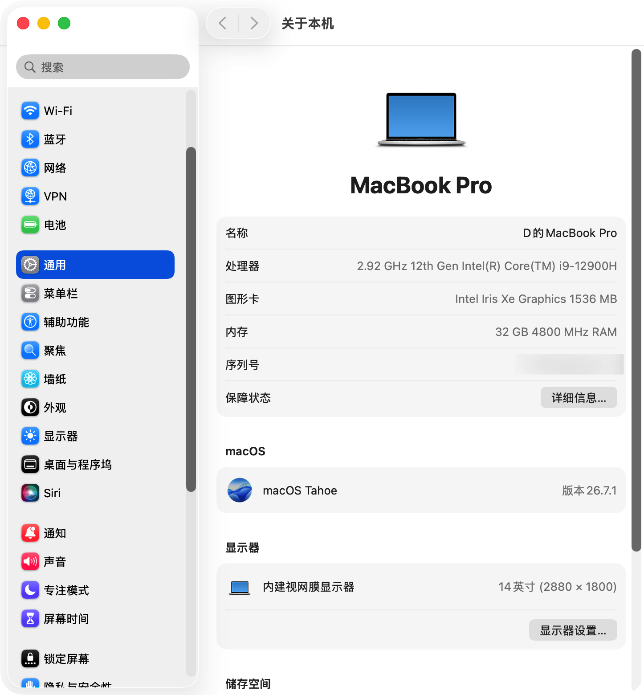
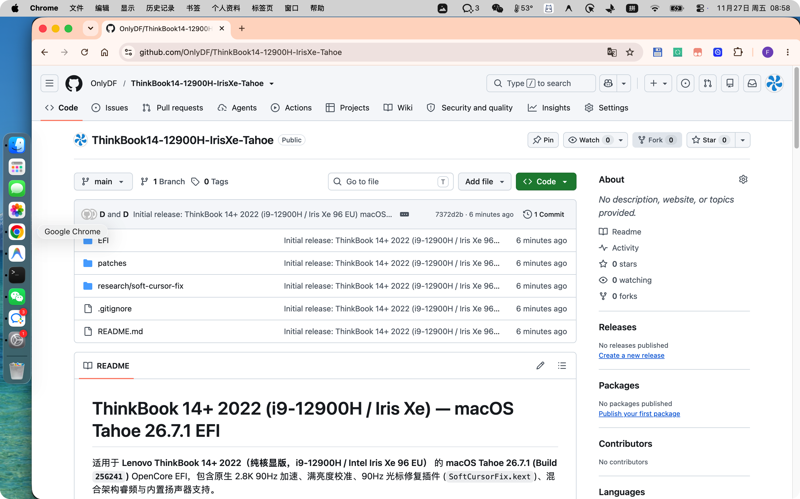

# ThinkBook 14+ 2022 (i9-12900H / Iris Xe) — macOS Tahoe 26.7.1 EFI

**中文** | [English](README.en.md)

适用于 **Lenovo ThinkBook 14+ 2022（纯核显版，i9-12900H / Intel Iris Xe 96 EU）** 的 **macOS Tahoe 26.7.1 (Build `25G241`)** OpenCore EFI，包含原生 2.8K 90Hz 加速、满亮度校准、90Hz 光标修复插件 (`SoftCursorFix.kext`)、混合架构睿频与内置扬声器支持。

> **重要版本限制**：本方案的图形驱动与内核补丁强绑定 **macOS Tahoe 26.7.1 (`25G241`)**，请勿随意升级系统小版本。

---

## 实机截图

| 关于本机（i9-12900H / Iris Xe 1536 MB / 2880×1800） | 日常桌面（2.8K 90Hz HiDPI / 菜单栏温度 45°C） |
| :---: | :---: |
|  |  |

---

## 硬件配置与功能状态

| 模块 | 硬件 / 方案 | 状态 | 说明 |
| :--- | :--- | :---: | :--- |
| **机型** | Lenovo ThinkBook 14+ 2022（纯核显） | ✅ | BIOS 关闭 Secure Boot，硬盘模式 AHCI/NVMe，保持 E-cores 开启 |
| **CPU** | Intel Core i9-12900H (6P + 8E, 20 线程) | ✅ | `CpuTopologyRebuild` + `ngreenpm=64` 解锁混合架构 HWP/EPP 睿频、C8/C10 省电及 64W 持续功耗墙（突破 EC 默认 25W 限制） |
| **核显加速** | Intel Iris Xe 96 EU (`8086:46A6`) | ✅ | 仿冒 `9A49` + `NootedGreen` + `YogaGMSFix` (60 MiB GMS) + Metal 2 / Liquid Glass |
| **内屏显示** | AUO `B140QAN04.0` (2880×1800 @ 90Hz) | ✅ | 原生 `1440×900 @ 90Hz` HiDPI；`ngreenblmax=17777` 校准 0–100% 满亮度 |
| **90Hz 光标** | `SoftCursorFix.kext` (`-swcursor`) | ✅ | 解决 90Hz 硬件光标黑条纹问题，原生回退至 Metal 软件合成光标 |
| **声卡** | Realtek ALC257 (`alcid=99`) | ✅ | `AppleALC` + `SimpleHDA 1.0.2`（`MinKernel=25.0.0`），内置扬声器与麦克风正常 |
| **无线 / 蓝牙** | Intel AX210（替换原机 MT7921） | ✅ | `AirportItlwm-Tahoe` + `itlwm_he=1` 原生 Wi-Fi 6 菜单；`IntelBluetoothFirmware` + `BlueToolFixup` 支持 AirPods 自动切换 |
| **键鼠 / 触控板** | 内置键盘 + ELAN0662 (I2C) | ✅ | `VoodooPS2Controller` + `VoodooI2C` (`-vi2c-force-polling`) |
| **息屏与睡眠** | `XE-FBDPMS` + 禁用 S0ix | ⚠️ | **息屏复亮正常**；不支持 S3/S0ix 整机睡眠（必须禁用整机睡眠，见下文） |
| **硬解视频** | H.264 / HEVC (`-ngreengva`) | ✅ / 可选 | 默认已加入 `-ngreengva`，需配合上游 `VADriver` 安装生效；开启后 Apple Music / Apple TV+ FairPlay 不可用（不需要可移除） |
| **AirDrop / 雷电** | AWDL / Thunderbolt 3 | ❌ / 未启用 | Intel 网卡不支持 AirDrop/AWDL；雷电 SSDT 默认禁用 |

---

## 仓库结构

```text
.
├── EFI/
│   ├── BOOT/
│   └── OC/
│       ├── config.plist            # 日常主力加速配置（已集成全部调优，SMBIOS 已清空）
│       ├── config-install.plist    # 无仿冒安装 & 永久救援配置（SMBIOS 已清空）
│       ├── config-register.plist   # 一次性 9A49 注册过渡配置（SMBIOS 已清空）
│       ├── ACPI/                   # 机型 ACPI 补丁
│       ├── Drivers/                # OpenCore 驱动
│       └── Kexts/                  # 完整内核扩展（含 NootedGreen / YogaGMSFix / SoftCursorFix / SimpleHDA）
├── patches/
│   └── thinkbook-register.patch    # 适配 ThinkBook 的上游注册脚本补丁
├── research/
│   └── soft-cursor-fix/            # SoftCursorFix.kext 源码与本地编译脚本
└── tools/
    ├── xe-watchdog.py              # 轻量全机健康预警脚本（GPU/显存/崩溃/95°C 高温）
    └── XeNotify.swift              # macOS 原生常驻通知器源码（点击可弹出待确认终端命令）
```

---

## 快速上手指南

### 1. 生成并填入自己的 SMBIOS 三码
仓库中三份配置文件（`config.plist`、`config-install.plist`、`config-register.plist`）均已清空三码。  
使用 [GenSMBIOS](https://github.com/corpnewt/GenSMBIOS) 生成一套 **`MacBookPro16,2`** 信息，将 `SystemSerialNumber`、`MLB`、`SystemUUID`、`ROM` **同时填入三份 plist**。

### 2. 三阶段部署流程
1. **安装系统（`config-install.plist`）**
   - 将 U 盘的 `EFI/OC/config.plist` 临时替换为 `config-install.plist`（无核显仿冒，带 `-igfxvesa`）。
   - 引导安装 **macOS Tahoe 26.7.1 (`25G241`)** 至目标 NVMe 硬盘，进入桌面确认 `sw_vers -buildVersion` 为 `25G241`。
2. **注册 TGL 图形驱动（`config-register.plist`，仅运行一次）**
   - 切换 U 盘活动配置为 `config-register.plist` 并重启，确认 `IGPU` 呈现 `device-id = <499a0000>`。
   - 克隆上游 [Hackintosh-XPS13Plus-IrisXe-Tahoe](https://github.com/JulioNectar/Hackintosh-XPS13Plus-IrisXe-Tahoe)，应用本仓库的 `patches/thinkbook-register.patch`，运行 `zsh install.sh` 安装图形驱动、Metal bundle、shader compiler 并重建 AuxKC（在“隐私与安全性”中批准系统扩展）。
   - > **注意**：一旦系统卷写入了 TGL 驱动，**严禁再用 `config-register.plist` 引导**；任何时候需要无加速救援，只使用 `config-install.plist`。
3. **进入主力加速桌面（`config.plist`）**
   - 切回本仓库默认的 `EFI/OC/config.plist` 重启，即可进入原生 `2880×1800 @ 90Hz` Metal 2 加速桌面。
   - 确认稳定后，可将完整 `EFI` 复制到 macOS 所在 NVMe 硬盘的独立 EFI 分区，保留 U 盘作为应急救援盘。

---

## 推荐系统调优（装完必做）

### 1. 禁用整机睡眠，仅保留息屏复亮（强烈建议）
ThinkBook 14+ 2022 仅支持 Modern Standby (S0ix)，在 macOS 下进入整机睡眠会无法唤醒。执行以下命令锁死“只息屏、不睡眠”：

```bash
sudo pmset -a sleep 0 disablesleep 1 hibernatemode 0 standby 0 powernap 0 proximitywake 0 halfdim 1 disksleep 10
sudo pmset -c womp 0 displaysleep 10
sudo pmset -b displaysleep 3
sudo rm -f /var/vm/sleepimage
```

### 2. 双固态与 Windows 共存（互不干扰）
若 macOS 与 Windows 分别装在两块独立 NVMe 硬盘上，将内置 macOS 盘 OpenCore 的 `Misc > Security > ScanPolicy` 设为 **`257`**（仅扫描 APFS），OpenCore 将只引导 macOS；需要进入原厂纯净 Windows 时开机按 **`F12`** 选择 `Windows Boot Manager` 即可。

### 3. 日常流畅度与可选扩展
- **流畅度优化**：在「系统设置 → 辅助功能 → 显示」中开启 **降低透明度**，可显著降低 Tahoe Liquid Glass 毛玻璃的帧同步开销，提升 3D 地图、远程桌面等重图形应用流畅度。
- **Wi-Fi 6 (802.11ax)**：`config.plist` 已默认开启 `itlwm_he=1`（AX210 Wi-Fi 6 速率）。
- **H.264 / HEVC 硬解**：`config.plist` 已默认包含 `-ngreengva`，需参照上游仓库构建安装 `/Library/GPUBundles/AppleIntelTGLGraphicsVADriver.bundle` 后生效（如需要使用 Apple Music / Apple TV+ FairPlay 播放，移除 `-ngreengva` 即可）。
- **核心参数说明**：
  - `-xenobb`：跳过 `XE-BOOTHOLD` 启动期熄屏等待，避免开机黑屏锁死。
  - `ngreenblmax=17777`：匹配 `AUO B140QAN04.0` 面板 `96000` PWM 周期，恢复 100% 满亮度。
  - `-swcursor`：启用 `SoftCursorFix.kext`（移除该参数或加 `-swcursoroff` 即可关闭）。
  - `ngreenpm=64`：启用混合架构 CPU 睿频与节能策略，并将 MCHBAR PL1 功耗墙设为 64W（NootedGreen 支持范围 `5–64` W；解决 EC 默认锁死 25W 的问题；偏爱静音可改为 `ngreenpm=45`，通过 `sysctl debug.xepm` 查看状态）。
  - `-ngreengva`：配合 `AppleIntelTGLGraphicsVADriver.bundle` 开启 H.264 / HEVC 视频硬解。
  - `itlwm_he=1`：为 AX210 开启 802.11ax (Wi-Fi 6) 模式。
- **锁定系统版本（禁用 macOS OTA 更新）**：驱动与 `SoftCursorFix.kext` 依赖 `25G241` 内核符号，建议执行 `sudo softwareupdate --schedule off` 并在 `/etc/hosts` 屏蔽 `swscan.apple.com` / `swcdn.apple.com` / `swdist.apple.com` / `mesu.apple.com` / `gdmf.apple.com` / `updates.cdn-apple.com`（不影响 App Store 与 iCloud）。
- **可选全机健康预警工具（`tools/xe-watchdog.py` + `tools/XeNotify.swift`）**：可配合 `LaunchAgent` 每 45 秒静默巡检 `IntelAccelerator` `recoveryCount`、全局 GART 显存、单进程 GPU Helper 显存膨胀（`>= 1400 MB`）、`ReportCrash` 崩溃循环与 CPU 封装高温（`>= 95°C`），命中时弹出原生提醒，点击后在终端预填精准 `kill` 命令等待回车确认。

---

## 已知问题与注意事项

- **请勿安装 iStat Menus（尤其不要开启开机自启）**：实测安装 iStat Menus 并设为开机自启后，每次开机进入桌面、顶部菜单栏刚出现 iStat Menus 状态项即会触发系统卡死。若已安装导致开机反复卡死，请切换至无加速救援配置（`config-install.plist`）进入系统后关闭自启或卸载 iStat Menus。
- **麦克风 / 摄像头权限不弹窗（`amfi_get_out_of_my_way=1` 副作用及解法）**：
  - 由于加载本地自签核显驱动（`AppleIntelTGLGraphicsMTLDriver` / `libxedrv.dylib`）必须保留 `amfi_get_out_of_my_way=1`（实测旧版 `AMFIPass.kext 1.4.1` 在 Tahoe `25G241` 下会导致 `WindowServer` 崩溃无法进桌面），macOS 的 `tccd` 不会自动弹出麦克风/摄像头授权框，隐私列表为空。
  - **已验证解法（免重启、不动 EFI）**：先用 `osascript -e 'id of app "WeChat"'` 查出目标应用的 Bundle ID，再直接向当前用户的 `TCC.db` 写入授权（写入后重开目标应用即生效，系统设置列表也会立即显示）：
    ```bash
    # 授予麦克风权限（摄像头将 kTCCServiceMicrophone 替换为 kTCCServiceCamera）
    sqlite3 "$HOME/Library/Application Support/com.apple.TCC/TCC.db" \
      "INSERT OR REPLACE INTO access (service, client, client_type, auth_value, auth_reason, auth_version, csreq, flags) VALUES ('kTCCServiceMicrophone', 'com.tencent.xinWeChat', 0, 2, 2, 1, NULL, 0);"
    ```

---

## 致谢

本项目站在以下开源社区工作的基础之上，特此致谢：
- [Hackintosh-XPS13Plus-IrisXe-Tahoe](https://github.com/JulioNectar/Hackintosh-XPS13Plus-IrisXe-Tahoe) — macOS Tahoe Iris Xe 加速、NootedGreen、libxedrv、XE-PM 与工具链
- [Hackintosh-LenovoYoga-IrisXe-Tahoe](https://github.com/willyyypatootieee/Hackintosh-LenovoYoga-IrisXe-Tahoe) — 12 代 `46A6` 60 MiB GMS 修复 (`YogaGMSFix.kext`)
- [ThinkBook14-AlderLake-Hackintosh](https://github.com/ruixian94/ThinkBook14-AlderLake-Hackintosh) — ThinkBook 14+ 2022 ACPI 与外设基线
- [SimpleHDA](https://github.com/laobamac/SimpleHDA) — macOS Tahoe AppleHDA 音频恢复方案
- [Acidanthera](https://github.com/acidanthera) — OpenCore、Lilu、VirtualSMC、AppleALC、BlueToolFixup 等核心驱动
- **ChatGPT 6.2 Sol** & **Gemini 4 Neon** — 在驱动逆向分析、`SoftCursorFix` 开发调试及文档整理过程中提供的协助
